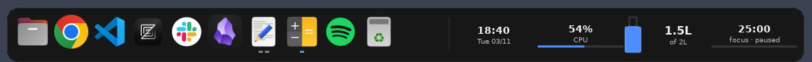
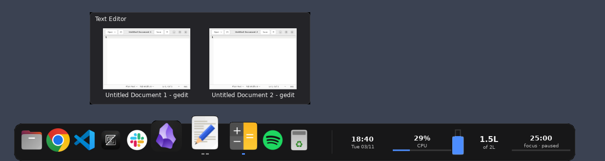
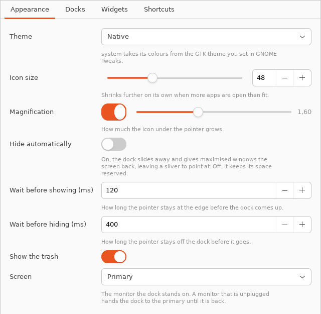

# Doca

A native dock for Linux with per-environment profiles and live widgets.
No Electron, no webview. A Linux port of [PrimoDock](https://dock.oprimo.dev) (macOS).



## Requirements

- X11 session
- GNOME Shell 42+
- GTK3

## Build

```bash
sudo apt-get install -y pkg-config libgtk-3-dev
cargo build --release
```

## Try it

**In a sandbox** — a window with a nested X server, its own bus and its own
config, seeded from your Plank launchers. Your desktop is not touched. Close
the window to stop.

```bash
./scripts/sandbox.sh              # add --headless for screenshots and CI
```

**On your own session** — stops Plank, runs Doca in its place, and brings
Plank back on Ctrl-C.

```bash
./scripts/try-it.sh
```

If the dock ever gets in your way, switch to a text console (`Ctrl+Alt+F3`),
log in and run:

```bash
pkill -x doca-prefs; pkill -x doca-shell; pkill -x docad; setsid plank &
```

`Ctrl+Alt+F2` takes you back.

## Using the bar

- **Dots** under an icon: one per open window, up to three. The coloured one
  has the focus.
- **Window previews**: rest the pointer on a running app and its windows come
  up over it. Click one to bring it forward. Right-click lists them by title.
- **Reorder**: drag an icon or a widget tile along the bar. Dragging a running
  app in among the pins pins it.
- **Unpin**: pull a pin up off the bar and let go.
- **Bar menu**: right-click an empty spot for the theme, widgets, auto-hide,
  trash and **Preferences…**.



## Configuration

`$XDG_CONFIG_HOME/doca/config.toml` — or use the [preferences window](#preferences).

```toml
[appearance]
theme = "native"        # native, system, midnight or paper
icon_size = 48          # 24–96
magnification = 1.6     # 1.0 turns the lens off
auto_hide = false
reveal_delay = 120      # ms at the edge before it comes up
hide_delay = 400        # ms off the dock before it goes
show_trash = true
icon_theme = ""         # empty follows the system
gtk_theme = ""
cursor_theme = ""
monitor = ""            # empty is the primary; or an xrandr output name

[[environments]]
name = "Work"
workspaces = [0, 1]
pinned = ["code", "dev.warp.Warp"]
widgets = ["clock", "pomodoro", "cpu", "battery"]
folders = ["~/Downloads"]

[[environments]]
name = "Personal"
workspaces = [2, 3]
pinned = ["discord", "spotify"]
widgets = ["clock", "music"]
```

- `pinned` takes `.desktop` file names without the extension.
- An environment with no `workspaces` covers every workspace no other one claims.
- `theme = "system"` takes its colours from the GTK *Applications* theme (the
  GNOME Shell theme is out of reach). A theme that defines none of the colours
  it needs falls back to `native`.
- A path in `folders` opens as a grid of its contents.
- With GNOME's *Reduce animation* on, nothing on the bar animates.

### Widgets

A widget is a tile that draws its own state. Click it to open a panel with its
controls.

| id | shows | panel |
|---|---|---|
| `clock` | time and date | |
| `calendar` | today and the next events on GNOME's calendars | |
| `battery` | charge and time left | |
| `cpu` | CPU usage | |
| `network` | up and down rates | |
| `music` | what is playing (MPRIS) | play/pause, previous, next |
| `pomodoro` | focus and break blocks | start/pause, skip, reset |
| `stopwatch` | time counting up, with laps | start/stop, lap, reset |
| `timer` | time counting down | start/pause, +1 min, reset |
| `time-progress` | how much of a span has gone | next span, today |
| `countdown` | days to a date | |
| `water` | glasses drunk against a goal | one more, one less, reset |
| `note` | a line you leave yourself | |
| `claude` | Claude Code token usage | |

Settings, for the widgets that have them:

```toml
[widgets.countdown]
date = "2026-12-25"
label = "until Christmas"

[widgets.note]
text = "Call the dentist\nThursday at four"

[widgets.timer]
minutes = 15

[widgets.water]
goal = 8

[widgets.calendar]
ahead = "week"          # today, 3-days, week or month
all_day = true

[widgets.claude]
mode = "five-hours"     # five-hours, week or tokens
window = "today"        # for tokens: 5h, today or 7-days
budget = 0              # 0 for none
plan = false            # read the plan's limits from Claude Code's status line
```

The `claude` widget reads the usage counts Claude Code writes under
`~/.claude` (or `$CLAUDE_CONFIG_DIR`). Only counts are kept, and nothing leaves
the machine.

With `plan` on, the dock sets `docad claude-statusline` as the `statusLine` in
Claude Code's `settings.json`. Claude Code hands that command the plan's
five-hour and weekly share; it keeps only `used_percentage` and `resets_at` of
each, in `$XDG_RUNTIME_DIR/doca/claude-limits.json`, and the five-hour and week
modes show the plan's share while it has not reset. A status line you already
had is still run with the same input and is what Claude Code shows; switching
`plan` off puts it back as it was.

Counters such as the water glasses live in `$XDG_STATE_HOME/doca/state.toml`,
apart from the config, and start over each day.

## Environments and shortcuts

Each environment is its own dock. With `workspaces` set, the dock follows the
workspace; without, you switch by key.

The desktop owns the keyboard, so bind keys in the **Shortcuts** tab of the
preferences, or with the script:

```bash
./scripts/bind-key.sh                    # <Super>e cycles environments
./scripts/bind-key.sh '<Super>1' Work    # one key to one environment
./scripts/bind-key.sh --items --take     # <Super>1..9 open the n-th icon
./scripts/bind-key.sh --focus '<Super><Alt>d'   # keyboard to the dock
./scripts/bind-key.sh --list
```

`--take` clears GNOME's own `<Super>1..9` bindings for those keys;
`gsettings reset` gives them back. The script's header lists the rest
(`--remove`, `--back`, `--auto-hide`, `--widget`).

With the keyboard on the dock: arrows or Tab move, Enter opens, Menu or
Shift+F10 opens the menu or panel, Esc gives the keyboard back.

## Preferences

```bash
doca-prefs
```

Also under **right-click → Preferences…**. Every change applies at once, with
no Apply button.

- **Appearance**: theme, icon size, lens, auto-hide, trash, screen.
- **Docks**: add, rename, reorder and remove environments; their workspaces,
  pins and widgets.
- **Widgets**: each widget's settings, and which docks show it.
- **Shortcuts**: keys for cycling and for each dock, written to GNOME's
  custom keybindings.



## D-Bus

Everything the preferences window does goes through the daemon on the session
bus, so it can be scripted too:

```bash
gdbus call --session --dest io.github.gusmartins499.Doca \
    --object-path /io/github/gusmartins499/Doca \
    --method io.github.gusmartins499.Doca1.SetAppearance \
    '{"theme": <"midnight">, "icon_size": <int32 64>}'
```

`gdbus introspect` on the same name and path lists every method — switching
environments, pinning, widget actions, settings. Invalid input is refused with
the reason; nothing is written.

## Development

```
crates/doca-ipc     shared D-Bus contract
crates/docad        the daemon: windows, workspaces, config, widgets
crates/doca-shell   the bar
crates/doca-prefs   the preferences window
```

The daemon owns the state and is the only writer of the config; the bar and
the preferences window are clients on the bus.

```bash
cargo test                                         # everything without a display
./scripts/dev-session.sh                           # nested X on :9, debug build
DISPLAY=:9 cargo test -- --ignored                 # tests that need real GTK
cargo build --release && ./scripts/check-live.sh   # end-to-end, on its own bus and dconf
```

`dev-session.sh` needs `xserver-xephyr xvfb openbox dbus`. To move or click the
pointer on a headless display:

```bash
DISPLAY=:9 cargo run -p docad --example warp-pointer -- 700 1035 click:3
```

## Not implemented

Live window previews: the picture is taken once, when the previews open.
